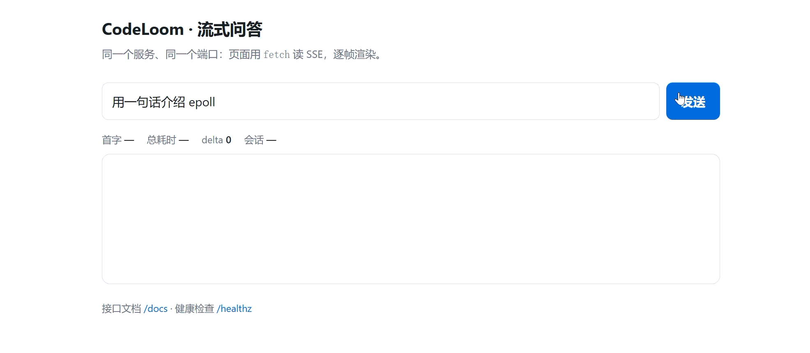

# CodeLoom（码络）· 可溯源的多 Agent 工程知识助手

> **一句话**：面向**自有工程语料**（源码 + 项目文档）的多 Agent 问答服务。
> 卖点不是「用了 LangChain」，而是**用服务器思维把 LLM 服务做稳**：分层边界、流式、限流、
> trace-id 日志、双探针、一条命令起容器 —— 以及后续每个答案都能溯源到文件行号。

当前状态：**v0.1 完成**。RAG 与多 Agent 分别在 v0.5 / v1.0。

| 版本 | 范围 | 状态 |
|---|---|---|
| v0.1 | `/chat` + `/chat/stream`(SSE) + SQLite 多轮 + 1 个本地工具 + 限流 + 结构化日志 + Docker | ✅ |
| v0.5 | 语料加载 → 切分 → bge Embedding → Chroma → 重排 → 文件行号引用 → 评测基线 | 计划中 |
| v1.0 | LangGraph Supervisor + checkpointer + 自研 MCP Server + Langfuse trace + step limit | 计划中 |


---

## 与 server2 的关系

```
server2  = 自己造的 C++ 高并发传输层  -> 懂 epoll / Reactor / 背压 / 优雅关闭 / 压测
CodeLoom = 在这套底层认知上盖的 Python + LLM 应用层
```

| server2 的能力 | 在 CodeLoom 的落点 |
|---|---|
| 主从 Reactor / epoll ET | `asyncio` 事件循环（uvicorn） |
| EPOLLOUT 写半包 / 抽干 | SSE 生产快于消费时的背压与慢客户端 |
| 信号量 / 锁 | 滑动窗口限流 + `asyncio.to_thread` 串行化 SQLite |
| signalfd 优雅关闭 | `lifespan` 关闭时释放数据库连接 |
| MSG_NOSIGNAL / 对端断开 | 客户端断流 → `finally: await stream.aclose()` 关上游（省钱） |
| 压测方法论 | 后续压测表复用同一套（wrk2 / pidstat / fd） |

---

## 架构

```
                  +---------------------------------------------+
  curl / 前端 ---> | uvicorn (workers=1)                         |
                  |   middleware: request_id + 结构化 access 日志 |
                  +----------------------+----------------------+
                                         v
                  +---------------------------------------------+
                  | router/   /chat   /chat/stream              |
                  |           /sessions*   /healthz   /readyz   |
                  +----------------------+----------------------+
                                         v
                  +---------------------------------------------+
                  | service/  ChatService                       |
                  |   会话编排 / FC 循环(<=3 步) / 异常翻译        |
                  +---------+----------------------+------------+
                            v                      v
                  +-------------------+   +----------------------+
                  | client/llm.py     |   | tools/registry.py    |
                  | 唯一 import openai |   | ast 白名单计算器      |
                  +---------+---------+   +----------------------+
                            v
                      DeepSeek API

                  db/store.py   SQLite(WAL)：会话 + 消息
```

分层规则（破了不会报错，只会烂）：

- `service/` 不许 `import fastapi`、不许 `import openai`、不许写 SQL
- `client/` 是唯一 import `openai` 的地方
- `tools/` 不认识 HTTP，也不知道 SDK
- 校验命令：`grep -rn "import fastapi\|import openai" src/app/service/` 应无输出

---

## 核心特性

- **流式问答**：`/chat/stream` 按 `meta -> delta... -> done` 推送；`X-Accel-Buffering: no` 防中间层缓冲
- **多轮记忆**：SQLite 落库，`session_id` 续聊；未知 id 返回 404，**不静默新建**
- **Function Calling**：本地计算器（`ast` 白名单，**禁用 eval**），最多 3 步，工具结果全部转成文本
- **限流**：滑动窗口（无边界突刺），按客户端 IP 分桶 + LRU 上限，超限 429 + `Retry-After`
- **结构化日志**：一行一个 JSON，`request_id` 用 `ContextVar` 贯穿中间件/业务/工具层
- **统一错误体**：`{code, msg, data, request_id}`，业务码与 HTTP 状态同源
- **双探针**：`/healthz` 不碰依赖（存活），`/readyz` 查 DB（就绪）
- **容器化**：多阶段构建、非 root、`/data` 卷、镜像内 HEALTHCHECK

---

## 快速开始

```bash
uv sync                                  # 安装依赖（Python >= 3.13）
cp .env.example .env                     # 填 APP_LLM_API_KEY
uv run uvicorn app.main:app --reload --port 8000 --no-access-log
```

不用 key 也能起：探针与会话接口正常，只有 `/chat*` 返回 502。

```bash
# 非流式
curl -s -X POST localhost:8000/chat \
  -H "Content-Type: application/json" \
  -d '{"message":"用一句话介绍 epoll"}'

# 流式（★ -N 不能省，否则 curl 会缓冲，看起来像"没有流"）
curl -N -X POST localhost:8000/chat/stream \
  -H "Content-Type: application/json" \
  -d '{"message":"你好"}'

# 探针
curl -s localhost:8000/healthz ; echo
curl -s localhost:8000/readyz  ; echo
```

> 默认 `max_tokens=200` 是**成本闸门**：长回答会被截断（正文停在半句或半个代码块中间，
> 日志里 `completion_tokens` 正好等于 200）。要完整答案就传 `"max_tokens": 600`。

### Windows PowerShell 验收

1. `curl` 是 `Invoke-WebRequest` 的别名，不支持 `-N` → 一律写 **`curl.exe`**
2. `Invoke-RestMethod` 在响应头没有 charset 时按 **ISO-8859-1** 解码，中文会变成 `æ¯ Linux`
   （JSON 按 RFC 8259 恒为 UTF-8，是 PS 5.1 的问题；服务端**不该**为此加非标准的 `charset`）
3. `-Body '中文字符串'` 会把非 ASCII 变成 `?` —— 实测入库是 `??A:?????`，
   模型只看到 `epoll` 这个 ASCII 词，答得"像对"其实问题已经丢了

正确姿势：请求体写 **UTF-8 无 BOM 文件**，响应落文件后按 UTF-8 读。

```powershell
[IO.File]::WriteAllText("$PWD\req.json", '{"message":"用一句话介绍 epoll","max_tokens":600}',
                        [Text.UTF8Encoding]::new($false))

curl.exe -s -X POST http://127.0.0.1:8000/chat -H "Content-Type: application/json" `
  --data-binary "@req.json" -o resp.json
(Get-Content resp.json -Encoding UTF8 -Raw | ConvertFrom-Json).data.reply

# 流式：先切控制台到 UTF-8，否则中文 token 在 cmd 里是乱码
chcp 65001 > $null
curl.exe -N -X POST http://127.0.0.1:8000/chat/stream -H "Content-Type: application/json" `
  --data-binary "@req.json"
```

> 想一条命令看全流程（探针 / 非流式 / SSE / trace id），用 Git Bash 或 WSL 跑
> `bash scripts/smoke.sh` —— 它内部全是 bash，绕开上面三个坑。

### 浏览器演示页

服务起来后打开 `http://127.0.0.1:8000/demo/`（容器映射的 8000 也一样）：

- 输入一句话 → **逐字渲染**，页面上直接显示「首字耗时 / 总耗时 / delta 帧数」
- 页面和接口**同一个 origin**（`GET /demo/` 由同一个 FastAPI 提供），所以
  `fetch('/chat/stream')` 不会触发 CORS —— 这是不需要 Vite/React 的原因
- 单文件、零依赖：`src/app/static/index.html`；`html=True` 让 `/demo/` 直接返回它



### 一次真实调用

```bash
$ curl -s -X POST localhost:8000/chat -H "Content-Type: application/json" \
       -d '{"message":"用一句话介绍 epoll"}' | jq '.data'
{
  "reply": "epoll 是 Linux 提供的一种 I/O 多路复用机制：内核维护一个事件就绪列表……",
  "session_id": "fb259cb188714172953e5cba6b735c5b",
  "usage": {"prompt_tokens": 444, "completion_tokens": 114, "total_tokens": 558}
}
```

```bash
$ curl -N -X POST localhost:8000/chat/stream -H "Content-Type: application/json" \
       -d '{"message":"你好"}'
event: meta
data: {"session_id": "4cd9cbfb44344d77a83c6d1dffee3721", "model": "deepseek-flash"}

event: delta
data: 你好

event: delta
data: ！

... （同一句共 179 个 delta 帧，此处省略）

event: done
data: [DONE]
id: end
```

> 179 这个数字比任何注释都能证明「真流式」：上游按小块推，我们是收一块转一块。
> 上方动图就是同一次请求的录屏：首字 597 ms、总耗时 1343 ms、77 个 delta 帧。

### Docker

```bash
docker build -t codeloom:latest .

# ★ 用 -d --name 而不是 --rm：容器崩了要能看到日志和退出码
# ★ --restart unless-stopped：WSL 空闲会关发行版、dockerd 跟着停，
#   没有重启策略的话容器就一直是 Exited，得手动 docker start
docker run -d --name codeloom --restart unless-stopped \
  -p 8000:8000 \
  -v codeloom-data:/data \
  -e APP_LLM_API_KEY=sk-... \
  codeloom:latest
```

> 镜像里 `APP_DB_PATH=/data/sessions.db`；`/data` 必须挂卷，否则容器一删会话就没了。
>
> 更稳的传 key 方式：`printf 'APP_LLM_API_KEY=%s\n' 'sk-...' > ~/.codeloom.env && chmod 600 ~/.codeloom.env`，
> 然后 `--env-file ~/.codeloom.env`。★ 文件必须是 **LF** 换行（`printf` 天然是），
> CRLF 会把 `\r` 带进值里，表现为 401。

---

## 接口

| # | 方法 | 路径 | 作用 | 限流 |
|---:|---|---|---|---|
| 1 | POST | `/chat` | 一次性问答 | ✅ |
| 2 | POST | `/chat/stream` | SSE 流式问答 | ✅ |
| 3 | GET | `/sessions` | 会话列表 | ❌ |
| 4 | GET | `/sessions/{id}/messages` | 会话全部消息 | ❌ |
| 5 | DELETE | `/sessions/{id}` | 删除会话（消息级联） | ❌ |
| 6 | GET | `/healthz` | 存活探针（不碰依赖） | ❌ |
| 7 | GET | `/readyz` | 就绪探针（查 DB） | ❌ |

> 另有 `GET /demo/`：同源静态演示页（单文件 HTML，不计入 API 端点，也不出现在 `/docs` 的 OpenAPI 里）。

请求体（`/chat` 与 `/chat/stream` 相同）：

| 字段 | 类型 | 约束 | 说明 |
|---|---|---|---|
| `message` | string | 1–2000 | 用户这一轮说的话 |
| `session_id` | string \| null | 1–64 | 不传新建；传了续聊；**不存在 → 404** |
| `history_limit` | int | 1–200，默认 20 | 带多少条历史（越少越省钱） |
| `max_tokens` | int | 1–1000，默认 200 | 输出上限 |

成功响应统一为 `{code, msg, data, request_id}`；错误码：

| code | HTTP | 场景 |
|---|---|---|
| `VALIDATION_ERROR` | 422 | 请求体格式不对 |
| `NOT_FOUND` | 404 | 会话不存在 |
| `RATE_LIMITED` | 429 | 超限，带 `Retry-After` |
| `UPSTREAM_ERROR` | 502 | 模型服务不可用 |
| `INTERNAL_ERROR` | 500 | 我们自己的 bug（堆栈只进日志） |

### SSE 事件

```
event: meta       data: {"session_id":"...","model":"deepseek-flash"}
event: delta      data: 逐 token 正文（可能几十上百帧）
: ping            注释帧，长时间无 token 时保活
event: error      data: {"code":"UPSTREAM_ERROR","msg":"..."}   仅出错时
event: done       data: [DONE]
```

`done` 一定在最后：客户端靠它停止读取 —— 靠「连接关闭」表示结束，分不清正常结束和断网。

---

## 配置

全部来自环境变量（`.env` 不入库，`.env.example` 是唯一文档）。

| 变量 | 默认值 | 说明 |
|---|---|---|
| `APP_LLM_API_KEY` | 空 | 为空时服务可启动，但 `/chat*` 返回 502 |
| `APP_LLM_BASE_URL` | `https://api.deepseek.com` | OpenAI 兼容端点 |
| `APP_LLM_MODEL` | `deepseek-flash` | 用官方正名，不用旧别名 |
| `APP_LLM_THINKING` | `false` | 思考模式默认关（省 5~14 倍输出 token） |
| `APP_TIMEOUT_S` | `30` | 单次调用超时 |
| `APP_MAX_RETRIES` | `2` | 预留（v0.1 未接重试，见已知限制） |
| `APP_DB_PATH` | `./data/sessions.db` | 容器内是 `/data/sessions.db` |
| `APP_RATE_LIMIT` | `30` | 每窗口请求数 |
| `APP_RATE_WINDOW_S` | `60` | 窗口秒数 |
| `APP_LOG_LEVEL` | `INFO` | — |
| `APP_LOG_FORMAT` | `json` | `json` 生产 / `text` 本地开发 |

---

## 设计决策

| 决策 | 为什么 | 代价 |
|---|---|---|
| **SSE 而不是 WebSocket** | 单向推送足够；SSE 走普通 HTTP，代理/网关/鉴权链路不用改 | 不能客户端中途插话 |
| **流式不落库**（ADR-6） | 半句话入库会污染历史；`astream` 也拿不到 usage | 流式聊完历史只有 user 半边；成本统计缺流式 |
| **未知 `session_id` → 404** | `INSERT OR IGNORE` 会把「拼错 id」伪装成 200 并新开会话 | 会话被清理后旧 id 不能自动续上 |
| **`--workers 1`** | SQLite 的锁与限流器都是进程内的 | 只能单机纵向扩容 |
| **滑动窗口限流** | 固定窗口在边界会放过 2 倍流量；本项目不想给突发额度 | 每 key 存 N 个时间戳 |
| **不信任 `X-Forwarded-For`** | 该头可伪造，信它等于关掉限流 | 部署在代理后需额外配置可信代理 |
| **JSON 日志 + ContextVar** | 采集端按字段查，不解析字符串；不污染函数签名 | 人工直接读不如文本友好（`APP_LOG_FORMAT=text` 兜底） |
| **FC 最多 3 步** | 防模型无限调用工具烧钱 | 复杂任务直接给兜底文案 |

---

## 已知限制（v0.1 的真实边界）

1. **流式不落库**：用 `/chat/stream` 聊完，历史里只有 user；下一轮非流式会带上这条「孤儿 user」。流式也没有 usage，成本统计只覆盖非流式。
2. **限流是进程内的**：`--workers N` 下额度变成 N 倍；扩容前要换 Redis。按 IP 计数，NAT 后的用户共享额度。
3. **单写者 SQLite**：并发写会排队（`busy_timeout=5s`），适合单机小流量。
4. **没有鉴权**：任何能访问端口的人都能调 `/chat`；上公网前必须加 API Key / 网关门禁。
5. **重试未接**：`APP_MAX_RETRIES` 只是配置占位，`OpenAICompatClient` 显式关掉了 SDK 重试但没接 tenacity。
6. **工具只有一个**：计算器。RAG、多 Agent、MCP 在 v0.5 / v1.0。
7. **压测是单机下限**：每组只有 10 个样本、客户端与服务端同机，P99 实际等于最大值；不代表集群容量（见上文「压测」一节）。

---

## 测试

```bash
uv run pytest -q                                   # 89 passed
uv run pytest --cov --cov-report=term-missing      # TOTAL 94%
uv run ruff check . && uv run ruff format --check .
```

覆盖重点不是行数，而是**不会报错的错误**：

- 五步顺序（先落库再调模型）、usage 逐轮累加、未知 id 不静默新建
- SSE 帧顺序、404 不能变 200、真流式（门控替身，假流式会超时）
- FC：`tool_call_id` 一一配对、步数上限、工具失败不打断循环
- 限流：边界不放过 2 倍突发、`Retry-After` 精确、LRU 淘汰
- 日志：一行一个 JSON、trace id 贯穿、500 也带 id

> 关键用例做过**故障注入**验证：把实现改坏（id 写死 / usage 不累加 / 步数 +1 / `except` 收窄 / 去掉截断 / `extra=forbid` 改 `ignore`），对应用例都会失败。

---

## 压测

环境：Windows 本机 / `uvicorn --workers 1` / 关环并发 / 限流关闭 / 日志 WARNING。
完整口径、局限与复跑方式见 [`benchmark/report.md`](benchmark/report.md)。

| 组 | 并发 | 请求 | RPS | P50 | P95 | P99 | 关键指标 |
|---|---:|---:|---:|---:|---:|---:|---|
| `probe` `/healthz` | 20 | 9297 | **928** | 14 ms | 66 ms | 104 ms | 纯本地，不碰依赖 |
| `chat` `/chat` | 2 | 10 | 1.5 | **1304 ms** | 1569 ms | 1569 ms | token 4490 + 683 |
| `stream` `/chat/stream` | 2 | 10 | 1.8 | 1091 ms | 1286 ms | 1286 ms | **TTFB P50 609 ms**，delta 均值 51 |

三个结论：

1. **我们的开销只占端到端 1~2%**：`/healthz` P50 14 ms vs `/chat` 1304 ms、`/stream` TTFB 609 ms。
   优化业务代码不会让聊天变快，瓶颈在上游生成。
2. **流式把首字延迟砍半**：609 ms vs 1304 ms。这是产品指标，不是服务器指标。
3. **`/chat` 没有排队**：`RPS ≈ 并发 / 延迟`（1.5 ≈ 2/1.304）。
   等式成立说明服务端没有积压；低于这个值才说明有排队。

> 局限：每组只有 10 个样本（P99 等于最大值）、同机压测（客户端与服务端抢 CPU）、
> 单进程、Windows 定时器精度约 15 ms。数字是**单机下限**，不是集群容量。

---

## 目录结构

```
codeloom/
├── Dockerfile / .dockerignore
├── pyproject.toml / uv.lock
├── docs/demo.gif               # README 演示动图
├── src/app/
│   ├── main.py                 # create_app + lifespan + request_id 中间件
│   ├── core/                   # config / deps / errors / ratelimit / logging / sse
│   ├── router/                 # chat / sessions / health
│   ├── service/chat_service.py # 业务编排（五步 + FC 循环 + 流式）
│   ├── client/llm.py           # LLMClient 协议 + OpenAI 兼容实现 + FakeClient
│   ├── tools/registry.py       # 工具 schema + 派发 + ast 白名单计算器
│   ├── db/store.py             # SQLite(WAL) 会话与消息
│   ├── schema/chat.py          # Pydantic 契约
│   ├── prompts/system.py       # 系统提示词
│   ├── static/index.html       # 演示页（/demo/，同源，零构建）
│   └── agent|rag|mcp_server|obs # v0.5 / v1.0 预留
├── tests/                      # 89 例
├── benchmark/                  # 压测：loadgen.py（probe/chat/stream）+ run.sh
├── scripts/smoke.sh            # 端到端冒烟（探针 / 非流式 / SSE / trace id）
└── eval/                       # 评测脚本（v0.5 起填充）
```

---

## License

MIT，见 [LICENSE](LICENSE)。
